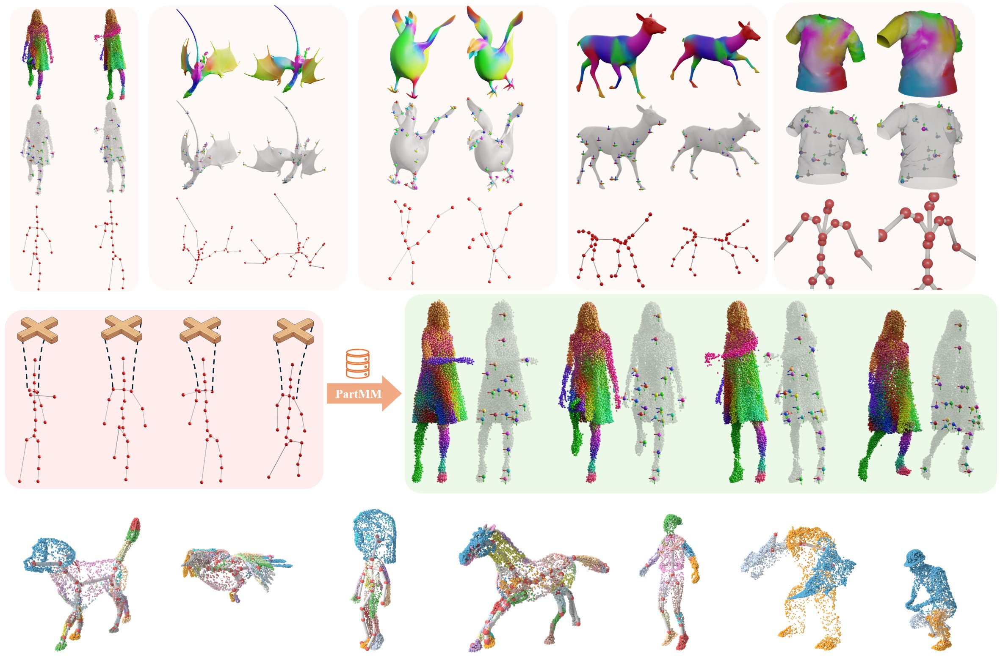
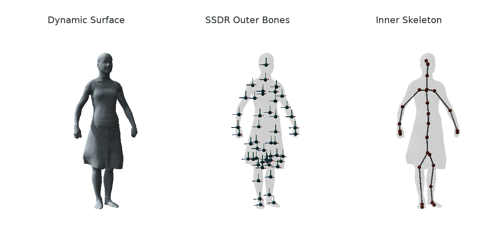
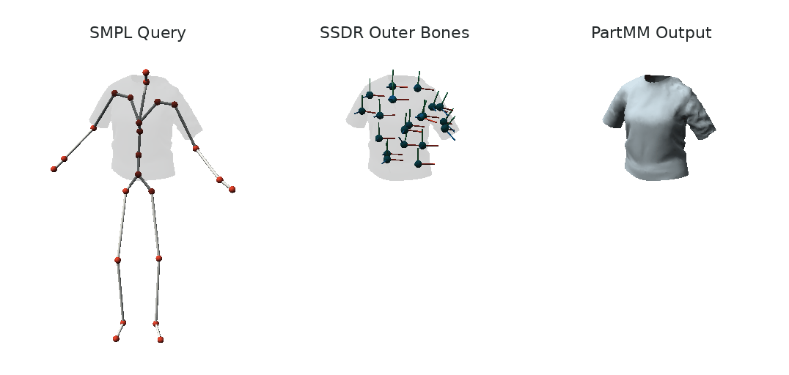

# GaussiAnimate



**Reconstruct and Rig Animatable Categories with Level of Dynamics**

[](https://cookmaker.cn/gaussianimate)
[](https://arxiv.org/abs/2604.08547)
[](experiments/README.md)
[](LICENSE)

GaussiAnimate turns a temporally registered 3D point sequence into a portable
**skelebone** representation: free-form outer bones for expressive deformation,
an inner kinematic skeleton for control, and the motion that connects them.

The core library does not assume a particular reconstruction method. Its input
can come from a tracked mesh, Dynamic 3D Gaussians, a monocular Gaussian model,
or any other system that gives the same material point a stable index over time.

```text
registered points -> skelebone extraction -> skelebones.npz
                                               |
novel inner pose -------------------------> PartMM -> animated points
```

## Start Here

There are two ways into this repository. Most users only need the first one.

| I want to... | Start with |
| --- | --- |
| Rig my own registered point sequence | [Quick start](#quick-start) |
| Understand the representation | [What is a skelebone?](#what-is-a-skelebone) |
| Call the library from Python | [Python API](#python-api) |
| Transfer a new motion | [Animate with PartMM](#animate-with-partmm) |
| Copy PartMM into another project | [Standalone PartMM guide](partmm/README.md) |
| Reproduce a paper table or figure | [Paper experiments](#paper-experiments) |
| Find a module or config | [Repository tour](#repository-tour) |

## Quick Start

### 1. Install the lightweight core

The Python core supports Python 3.8 through 3.11. Use Python 3.10 on Linux for
the full research pipeline; this is the environment used for the source-release
installation and native-backend checks.

```bash
python -m pip install --upgrade pip setuptools wheel
python -m pip install -e .
```

This installs the data model, I/O, kinematics, BVH export, PartMM, and the
experiment configuration tools. Geometry extraction has two native
dependencies and is installed separately below.

Install only the extras you need; the base package does not install PyTorch.

| Extra | Purpose |
| --- | --- |
| `ssdr` | SciPy sparse weights for the native SSDR binding |
| `geometry` | Open3D, SciPy, libigl 2.5.1, mesh I/O and plotting |
| `visualization` | Open3D, Pillow and Matplotlib previews |
| `evaluation` | Image metrics, including LPIPS |
| `research` | Torch/Torchvision, SMPL-X, HDF5, Trimesh and TensorBoard adapters |
| `gui` | Optional pose editor |
| `dev` | Tests and distribution builds |

Gaussian training and rendering still use their upstream CUDA environments
and rasterizers; these extras do not replace those installations. SMPL/SMPL-X
model files and datasets must be obtained separately.

### 2. Validate an input sequence

The canonical input is one registered point trajectory, stored as
`sequence.npz`. Every frame must contain the same material points in the same
order.

```bash
gaussianimate /path/to/sequence.npz --validate-only
```

For the AMA `T_samba` example below, validation reports:

```json
{
  "schema_version": 1,
  "frames": 175,
  "points_per_frame": 9971,
  "fps": 30.0,
  "registration_assumed": true,
  "faces": 19938,
  "dtype": "float64"
}
```

Validation is inexpensive and catches the most common mistakes before SSDR or
surface processing begins. The complete array contract is documented under
[Input Contract](#input-contract).

### 3. Enable geometry extraction

The repository includes both small native backends: a focused CGAL curve
skeleton executable and a lightweight `pyssdr` binding around the Dem Bones
headers. Install their system headers once:

```bash
# Ubuntu
sudo apt-get install build-essential cmake libcgal-dev libeigen3-dev python3-dev libx11-6 libgl1 git fonts-dejavu-core libegl1 libegl-mesa0

# macOS
brew install cmake cgal eigen
```

Then build and verify both backends with one command:

```bash
bash scripts/install_geometry.sh
```

The script installs the Python geometry extra, compiles `pyssdr` into the
selected Python environment, and installs `curve_skeleton` under
`.native/bin/`. To build only one backend:

```bash
bash scripts/install_geometry.sh --pyssdr-only
bash scripts/install_geometry.sh --curve-only
```

The Python package supports NumPy 1.x (`numpy<1.26`); the installer rejects
NumPy 2 before loading the pinned pybind11 binding. You can override the
Python, install prefix, or module directory through the script's documented
flags. Run `bash scripts/install_geometry.sh --help` for the complete list.

The curve executable uses CGAL's GPL-licensed Surface Mesh Skeletonization
package and is therefore kept in a clearly separated GPL directory. The MIT
Python packages call it as an external process and do not link against it.

### 4. Run the real AMA example

The core example uses all 175 registered frames of AMA `T_samba`, not a
generated fixture or a cached skeleton. Point the runner at your local copy:

```bash
export GA_AMA_ROOT=/path/to/AMA
python -m skelebone.examples.ama outputs/ama_skelebone
```



Our checked run processes 9,971 vertices and 19,938 shared triangles per frame.
With the current motion-initialized SSDR protocol, the 50-bone request retains
50 active outer bones, and curve analysis produces a 28-joint inner
skeleton. The script writes the canonical input,
portable bundle, BVH, manifest, every intermediate, and the Open3D animation
above under `outputs/ama_skelebone/`. The three synchronized panels share one
fixed `Y`-up camera, so surface motion, free-form outer bones, and the inner
kinematic hierarchy can be compared frame for frame.

### 5. Extract your own skelebones

```bash
gaussianimate /path/to/sequence.npz outputs/my_asset \
  --mesh /path/to/rest_mesh.ply \
  --visualize
```

The mesh is optional, but a supplied mesh must be watertight. When no mesh is
provided and the registered faces are open, GaussiAnimate uses Poisson only to
create a temporary watertight proxy required by CGAL curve skeletonization.
SSDR always runs on the original registered point sequence; the Poisson mesh
does not replace the input geometry, reconstruction result, skinning target,
or exported animated points.

The public hand-off is intentionally small:

```text
outputs/my_asset/
├── skelebones.npz       complete representation consumed by PartMM
├── motion.bvh           portable inner-skeleton motion
├── manifest.json        dimensions, configuration, and artifact paths
├── skelebone.png        optional inspection figure
├── ssdr/                outer-bone decomposition
├── curve_skeleton/      canonical curve and surface correspondence
├── skinning_curve_skeleton/
└── kinematic_tree/      hierarchy and temporal tracking
```

If the command finishes, downstream code normally needs only
`skelebones.npz`. The remaining directories make each geometric step
inspectable and reproducible.

## What Is a Skelebone?

Non-rigid surfaces need two different kinds of structure. A small set of free
rigid motions can reproduce cloth, fur, and soft deformation well, but those
motions are awkward to edit. A conventional joint hierarchy is easy to
control, but cannot express the same surface dynamics by itself.

GaussiAnimate keeps both and binds them explicitly:

| Component | Representation | Role |
| --- | --- | --- |
| Outer bones | SSDR weights and per-frame rigid transforms | Compactly reproduce observed non-rigid motion |
| Skinning curve | Mean-curvature curve with projected bone influence | Locate meaningful transitions between outer bones |
| Inner skeleton | A rooted kinematic tree | Provide interpretable joints and editable local rotations |
| Motion binding | Partwise Motion Matching (PartMM) | Retrieve and blend outer-bone motion for a new inner pose |

The distinction matters in code. `J` inner joints and `B` outer bones are not
required to have the same count: poses are stored over `J`, while skinning
weights and free-form transforms are stored over `B`.

## Input Contract

`save_point_sequence` writes the canonical schema:

| Field | Shape | Required | Meaning |
| --- | --- | --- | --- |
| `points` | `[T, N, 3]` | yes | Registered point positions |
| `faces` | `[M, 3]` | no | Triangle indices shared by every frame |
| `fps` | scalar | no | Frame rate; defaults to `30` |
| `schema_version` | scalar | written by the helper | Current writer version, `1` |

Registration is the essential assumption: point `n` must refer to the same
material point in every frame. A changing point count or independently sampled
frames are not valid inputs.

Orientation and physical units may be chosen freely as long as they stay
consistent. Scale still matters, however: extraction includes absolute distance
controls such as `--joint-merge-distance 0.08`. Normalize unusually large or
small assets, or tune the distance parameters for their scale.

For Gaussian inputs, `points` is typically the time series of Gaussian means.
Colors, opacity, covariance, and rotations are not part of the core input
contract; experiment adapters may keep them for rendering and evaluation.

## Output Contract

The stable bundle contains no pickled Python objects and can be loaded with
NumPy or the public helper:

| Array | Shape | Meaning |
| --- | --- | --- |
| `rest_joints` | `[J, 3]` | Inner skeleton in the bind pose |
| `parents` | `[J]` | Acyclic parent hierarchy; `-1` marks the root |
| `weights` | `[N, B]` | Normalized outer-bone skinning weights |
| `source_points` | `[N, 3]` | Canonical points used by PartMM |
| `local_rotations` | `[T, J, 4]` | Scalar-first quaternions `[w, x, y, z]` |
| `root_translation` | `[T, 3]` | Displacement from the bind root, not an absolute world position |
| `bone_transforms` | `[T, B, 4, 4]` | Observed free-form outer-bone motions |

The bundle also records relative paths to intermediate artifacts so that a
result can be inspected without coupling consumers to the pipeline internals.

## Python API

The high-level API mirrors the command line:

```python
from skelebone import extract_skelebones

result = extract_skelebones(
    "sequence.npz",
    "outputs/my_asset",
    mesh="rest_mesh.ply",  # optional
)

bundle = result.bundle
print(bundle.skeleton.num_joints)
print(bundle.num_bones)
print(result.bundle_path)
```

The public surface is small on purpose:

- `DynamicPointSequence`, `Skeleton`, `PoseSequence`, and `SkeleboneBundle`
  define the representations.
- `save_point_sequence`, `load_point_sequence`, `save_bundle`, and
  `load_bundle` provide portable NPZ I/O.
- `extract_skelebones` is the end-to-end extraction entry point.
- `forward_kinematics`, `fit_pose_to_joint_positions`, and `export_bvh` expose
  reusable kinematic operations.
- `PartMMConfig`, `PartMotionMatcher`, and `animate` live in `partmm`.

Lower-level research interfaces for SSDR, surface preparation, curve
extraction, joint detection, and tracking are available under
`skelebone.extraction`.

## Animate with PartMM

`partmm/` is a standalone NumPy package: it can be copied directly into another
project without `skelebone` or the experiment code. See the
[standalone guide](partmm/README.md) for the direct-array contract and the real
HOOD/VTO T-shirt example.

A novel pose is another portable NPZ:

| Field | Shape | Meaning |
| --- | --- | --- |
| `local_rotations` | `[Q, J, 4]` | Scalar-first local joint quaternions |
| `root_translation` | `[Q, 3]` | Root displacement from the bind pose |
| `fps` | scalar | Output frame rate |

Create, edit, or import that pose and run:

```bash
gaussianimate-animate \
  outputs/my_asset/skelebones.npz \
  novel_pose.npz \
  animation.npz
```

`animation.npz` contains:

- `points [Q,N,3]`
- `bone_transforms [Q,B,4,4]`
- `joint_positions [Q,J,3]`
- retrieved source-frame indices for each skeleton part
- scalar `fps`

Run the example and generate a shared-scale temporal preview:

```bash
python -m pip install -e '.[visualization]'
export GA_HOOD_ROOT=/path/to/hood
export GA_VTO_ROOT=/path/to/vto-dataset
python -m partmm.examples.quickstart outputs/partmm_tshirt_demo
```



This example keeps the two representations explicit: the query motion is the
24-joint SMPL hierarchy, while the cloth deformation is driven by 20 SSDR outer
bones. The final panel is the PartMM-retrieved T-shirt motion.

For the optional pose editor:

```bash
python -m pip install -e '.[gui]'
gaussianimate-edit outputs/my_asset/skelebones.npz --output novel_pose.npz
```

## Paper Experiments

We have fixed several implementation bugs since the original experiments, so reproduced results may differ slightly from the values reported in the paper.

The paper code is organized around a rule that is easy to miss:

> A config says how an experiment should run. It is not evidence that the
> experiment has already reproduced the paper.

Every table, ablation, and runtime target has a declarative YAML config. The
catalog separately records whether its current evidence is verified, partial,
in progress, or blocked.

Run the audit before spending GPU time:

```bash
gaussianimate-paper-audit
gaussianimate-paper-audit --require-ready  # full-paper gate, not the source-release gate
```

The current catalog contains ten paper targets: one is verified, six are
partial, one is in progress, and two are blocked. Table 5 is the first target
that meets the repository's strict definition of a fully verified paper
reproduction.

**Release scope:** Table 3 numerical reproduction is deferred. Its configs and
evaluation code remain available, but this source release does not claim that
the table has been reproduced. For the direct reconstruction-to-SSDR rendering
path, see [SSDR followed by PSNR](experiments/README.md#ssdr-followed-by-psnr).

### Two config layers

The short `config.yaml` in each domain is a reusable registered-sequence preset.
Run it with `gaussianimate-experiment` when adapting the pipeline to your own
data. The table- and figure-specific schema expands datasets, cases, methods,
and stages into paper jobs and is run with `gaussianimate-paper`.

```bash
gaussianimate-experiment experiments/mesh/config.yaml --validate-only
gaussianimate-paper experiments/mesh/vto_animation.yaml --validate-only
```

### The three experiment tracks

#### Mesh

The mesh track asks whether PartMM can generalize garment and animal motion in
a low-data regime. Begin with `mesh/vto_animation.yaml` for VTO garments or
`mesh/dt4d_animation.yaml` for DeformingThings4D animals. Recovered and
recomputed results exist for both, but protocol and reported-number
discrepancies keep the paper targets partial.

#### Monocular Gaussian

This track studies unseen-view reconstruction and motion-aware skeleton
extraction from a monocular dynamic Gaussian model. Its main entry points are
`monocular_gaussian/novel_view.yaml`, `arap_ssdr_ablation.yaml`, and
`progressive_skeleton.yaml`. Missing renders and checkpoints block the first
two targets; all five progressive runs finish, but their topology does not yet
match the paper figure.

#### Multiview Gaussian

The multiview track starts from D3DGS and compares robust LBS, BoB, and PartMM
on held-out human poses. Use `multiview_gaussian/reconstruction.yaml` for the
shared reconstruction stage and `multiview_gaussian/novel_pose.yaml` for the
80/20 motion split. Current artifacts cover all 18 cases for D3DGS, robust
LBS, training-only SSDR, and paper-spec PartMM. The fresh PartMM runs are
complete but do not reproduce the paper's printed rendering row.

##### D3DGS: Known Trajectory Artifacts

The stored Actor01Seq2 D3DGS checkpoint contains Gaussian centers that start
near the body but drift into distant clusters in later frames, before SSDR,
BoB, or PartMM is applied. A first-frame template envelope does not catch
these trajectories: our 1.1x outward-envelope trial removed 461 skirt-edge
points but retained the distant clusters we inspected. Rendering PSNR alone
did not reveal this failure to clean the point trajectories.

See the [saved artifact analysis](experiments/multiview_gaussian/diagnostics/actor01_artifacts/README.md)
for the point-ID comparison, measured distances, and filtering results.
This remains an unresolved issue in that reconstruction input, not a verified
artifact-removal step in the experiment pipeline.

### Important BoB status

Twelve older BoB result sets and their held-out rendering metrics are retained,
but they use the previous 66-dimensional pose contract. The current adapter
requires the v2 contract: 69 pose dimensions, SMPL joints 1 through 23, and 23
rootless links. **Zero of the old BoB runs pass the current validator.** The
fresh 18-case v2 recomputation is complete: the released sigmoid-RGB Table 3
rerun summary records all 18 BoB cases (8 DNA-Rendering, 10 ActorsHQ) complete
with the current adapter.

Historical aggregates remain useful evidence, but they are not presented as
current trained models.

### Inspect a config before running it

These commands do not load a dataset or start training:

```bash
gaussianimate-paper experiments/mesh/vto_animation.yaml --validate-only
gaussianimate-paper experiments/mesh/vto_animation.yaml --list
gaussianimate-paper experiments/mesh/vto_animation.yaml --dry-run
```

Then select one dataset, case, and method:

```bash
# Mesh
gaussianimate-paper experiments/mesh/vto_animation.yaml \
  --dataset vto --case tshirt --method partmm --gpus 0

# Monocular Gaussian
gaussianimate-paper experiments/monocular_gaussian/novel_view.yaml \
  --dataset dnerf --case hook --method ours --gpus 0

# Multiview Gaussian
gaussianimate-multiview-pipeline status --full
gaussianimate-paper experiments/multiview_gaussian/novel_pose.yaml \
  --dataset dna_rendering --case dna_0012_11 --method smpl_partmm --gpus 0
```

Paper runs are config-driven and resumable. Each expanded job records its
configuration fingerprint, stage logs, `job.json`, method artifacts, and
metrics. Complete experiment roots aggregate `results.csv`, `averages.csv`,
`summary.json`, and `summary.md`. Use `--force` only when you intend to replace
a completed stage.

Execution modes are explicit:

- `native`: implemented by this repository's public packages.
- `external`: calls a recorded historical or upstream research workspace.
- `artifact`: evaluates an existing result without claiming it was trained
  here.
- `blocked`: declared for completeness, but refused because the available path
  would violate the intended protocol.

See [experiments/README.md](experiments/README.md) for datasets, resource
contracts, stage selection, GPU scheduling, output schemas, known protocol
discrepancies, and the complete blocker list.

## Experiment Resources

Large datasets, checkpoints, and independently licensed rasterizers are not
installed by `pip`. Resource manifests describe exactly what each adapter
expects:

```text
experiments/monocular_gaussian/resources.yaml
experiments/multiview_gaussian/resources.yaml
experiments/multiview_gaussian/pipeline.yaml
```

Useful preflight commands:

```bash
gaussianimate-monocular-resources --content-hash

gaussianimate-multiview-resources --full \
  --require-raw --require-runtime
```

The multiview release validator checks file readability, shapes, contiguous
80/20 splits, point coverage, provenance, and current method contracts rather
than treating a non-empty directory as success.

## Repository Tour

```text
GaussiAnimate/
├── skelebone/                  core representations and extraction pipeline
│   └── extraction/             SSDR, mesh, curve, joint, and tracking stages
├── partmm/                     standalone PartMM, example, visualization, and pose editor
├── experiments/
│   ├── engine/                 config composition, stages, cache, and reports
│   ├── methods/                shared protocol and artifact contracts
│   ├── mesh/                   VTO and DeformingThings4D
│   ├── monocular_gaussian/     RigGS-derived monocular experiments
│   ├── multiview_gaussian/     D3DGS human experiments
│   └── reproductions/          frozen evidence from related local codebases
├── tests/                      core, protocol, resource, and audit tests
├── pyproject.toml              package metadata and command-line entry points
└── THIRD_PARTY_NOTICES.md      upstream code, data, and license boundaries
```

If you are changing the representation, begin with `skelebone/types.py` and
`skelebone/io.py`. If you are adding a paper method, begin with
`experiments/methods/protocol.py` and the nearest domain config.

## Testing

Check the dependency-light core without installing a graphics or Torch runtime:

```bash
python -m pip install -e '.[dev]'
python -m pytest -q \
  tests/test_skelebone_core.py tests/test_skelebone_extraction.py \
  tests/test_partmm.py tests/test_partmm_modules.py \
  tests/test_partmm_fallback.py tests/test_skelebone_examples.py
```

For the full CPU test suite, install the experiment and visualization extras.
Install a matched Torch/Torchvision build for your platform first; CI uses
Torch 2.2.2 and Torchvision 0.17.2 from the PyTorch CPU index.

```bash
python -m pip install torch==2.2.2 torchvision==0.17.2 \
  --index-url https://download.pytorch.org/whl/cpu
python -m pip install -e '.[dev,geometry,visualization,evaluation,research]'
python -m pip check
OPENBLAS_NUM_THREADS=1 OMP_NUM_THREADS=2 python -m pytest tests -q
```

Keep these dependencies in one environment rather than borrowing another
environment's `site-packages`. The geometry extra pins `libigl==2.5.1`; newer
libigl releases use a different winding-number API.

The extraction contract test uses lightweight stand-ins for DemBones and the
curve executable. It verifies orchestration and artifact schemas; it does not
claim that every native dependency, dataset, or full GPU experiment ran in CI.
Native integration tests are opt-in: after building SSDR, set
`GAUSSIANIMATE_TEST_NATIVE_PYSSDR=1`; with CGAL/Eigen headers installed, set
`GAUSSIANIMATE_TEST_NATIVE=1` to compile and exercise curve extraction.

### Build a source release

```bash
python -m build
python tests/check_wheel.py dist/*.whl
```

The source archive includes the native backends, scripts, tests, configs,
licenses, and README previews. The wheel contains the public Python packages
and their declared resources. Datasets, checkpoints, local environments and
generated experiment runs are excluded from both Git and release archives.
Paper-result verification remains separate from installation and code tests.

## Practical Notes

**My input validates, but extraction fails.**  First confirm that point indices
are temporally registered. Then check `pyssdr`, the curve executable, surface
watertightness, and the scale-dependent thresholds in that order.

**Why does an experiment say `external` or `artifact`?**  Some baselines and
historical reconstruction stages retain their own repositories or licenses.
The mode makes that boundary visible instead of silently presenting an adopted
file as a local training run.

**Why are paper configs included when the audit is not green?**  Missing and
contradictory evidence is part of reproducibility work. Keeping the intended
protocol executable lets contributors close one gap at a time without hiding
what remains unresolved.

## Citation

If GaussiAnimate is useful in your work, please cite:

```bibtex
@article{wang2026gaussianimate,
  title   = {GaussiAnimate: Reconstruct and Rig Animatable Categories with Level of Dynamics},
  author  = {Wang, Jiaxin and Lyu, Dongxin and Cai, Zeyu and Dou, Zhiyang and Lin, Cheng and Chen, Anpei and Xiu, Yuliang},
  journal = {arXiv preprint arXiv:2604.08547},
  year    = {2026}
}
```

## License

The public Python packages are released under the [MIT License](LICENSE).
External tools, datasets, pretrained models, and recovered research artifacts
retain their own terms. Review [THIRD_PARTY_NOTICES.md](THIRD_PARTY_NOTICES.md)
before redistributing experiment resources.
