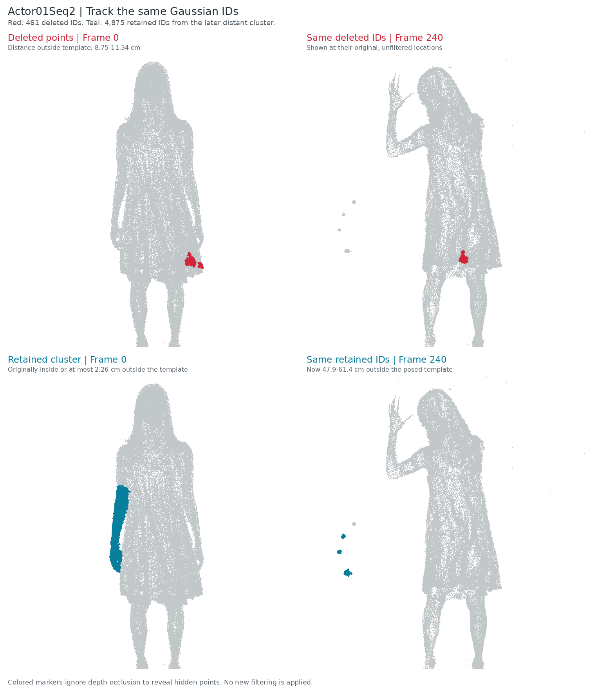

# D3DGS Trajectory Artifacts: Actor01Seq2

This record preserves the artifact investigation for the stored
`actorshq_actor01_seq2` D3DGS checkpoint. The distant clusters are already
present in its original Gaussian-center trajectories, before applying SSDR,
BoB, or PartMM. The investigation identifies the affected point tracks; it
does not establish the underlying training or implementation cause.

## What the Point IDs Show

The checkpoint contains 300 frames and 119,506 Gaussian centers per frame.
Sequence frame 0 corresponds to source image `000758.jpg`; frame 240 is
`000998.jpg`. The inspection uses camera 126.

| Tracked group | Count | Position in frame 0 | Position in frame 240 | First-frame selection |
| --- | ---: | --- | --- | --- |
| Deleted points | 461 | A small skirt-edge patch, 8.75-11.34 cm outside the template | Same IDs lie 0.36-7.10 cm outside the posed template | Deleted in all frames |
| Representative distant cluster | 4,875 | Near the arm; inside or at most 2.26 cm outside the template | 47.9-61.4 cm outside the posed template | Retained in all frames |

The second group is the visible left-side cluster selected in frame 240,
not a count of every artifact in the sequence. Its image-space selection
rectangle and exact distance ranges are recorded in [analysis.json](analysis.json).

Red marks the deleted IDs; teal marks the retained cluster IDs. Colored
markers ignore depth occlusion so hidden points remain visible. In the
earlier shell preview, 352 of the 461 deleted points were behind the template
from the capture camera, and the remaining markers occupied a small patch.
That preview showed frame 0, whereas the later point-cloud preview showed
frames 240-299. The distant positions therefore did not appear in the shell
view.

## The Filtering Trial

We posed the official Animatable Gaussians Actor01 clothing template using
SMPL-X/LBS and rigidly aligned it to the first-frame D3DGS centers. Foot-bottom
holes were capped in a copy. The envelope keeps the generalized-winding
interior plus points within a Euclidean distance of the triangle surface;
it does not scale the body vertices.

Here, `offset = (factor - 1) * reference_span / 2`, with a first-frame reference
span of 1.750095 m. The factor describes expansion along that reference span,
not a multiplier of volume. The mask is computed only at frame 0 and applied
unchanged to every frame and every per-Gaussian parameter.

| Envelope factor | Outward distance | Deleted | Retained |
| --- | ---: | ---: | ---: |
| 1.5x | 43.75 cm | 0 | 119,506 |
| 1.3x | 26.25 cm | 0 | 119,506 |
| 1.1x | 8.75 cm | 461 | 119,045 |

For the 1.1x trial, mean full-image PSNR on frames 240-299, camera 126, was
33.1062 dB both before and after filtering; foreground PSNR was 27.3025 dB.
These unchanged rendering scores do not mean the distant artifacts were
removed. The inspected distant cluster remained in the retained point set.

## Saved Evidence and Status

- [Measured point-track data](analysis.json)
- [Deleted original Gaussian IDs](deleted_ids.npy)
- [Retained cluster original Gaussian IDs](retained_cluster_ids.npy)
- Full local run: `experiments/runs/actor01_fixed_envelope_1p1/` (generated outputs, not versioned)
- Source resource: `resources/multiview/d3dgs/actorshq/actorshq_actor01_seq2/params.npz`

**Status: unresolved.** First-frame spatial filtering does not detect these
later trajectory artifacts and instead removes a different skirt-edge patch.
The original checkpoint has not been overwritten. No further filtering change
or replacement reconstruction is established by this analysis.
